# Exploración de la planificación de procesos en XV6

**Curso:** Sistemas Operativos
**Integrante:** Santiago Jurado González
**Repositorio:** https://github.com/SJuradoo01/xv6-riscv
**IA utilizada:** Google Gemini

## 1. Repositorio y entorno

- **Sistema operativo:** Ubuntu 26.04.1 LTS (Resolute Raccoon), ejecutado sobre WSL en Windows.
- **Commit de partida:** `fa2ddcb7ca87a77af579380a6eafd5aff163b44f` (el commit `37d5084` agrega `spin` y es posterior).
- **Herramientas:** riscv64-linux-gnu-gcc 15.2.0 (Ubuntu 15.2.0-16ubuntu1), QEMU 10.2.1, GNU Make 4.4.1.
- **Instalación:** `sudo apt install git build-essential gdb-multiarch qemu-system-riscv gcc-riscv64-linux-gnu binutils-riscv64-linux-gnu`

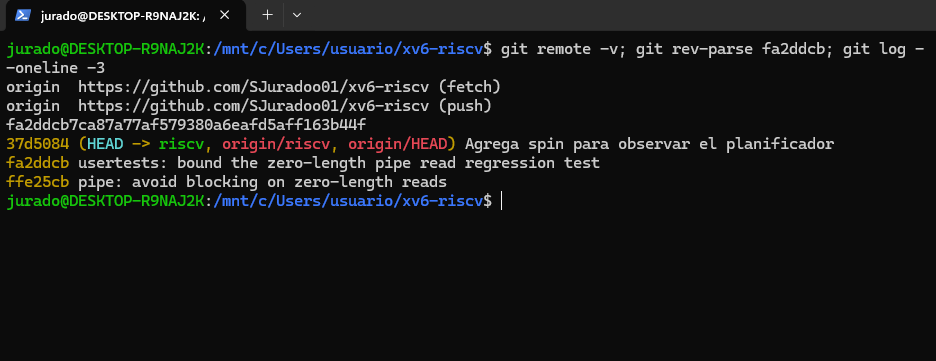
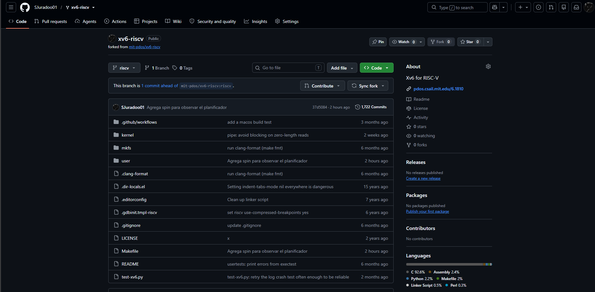
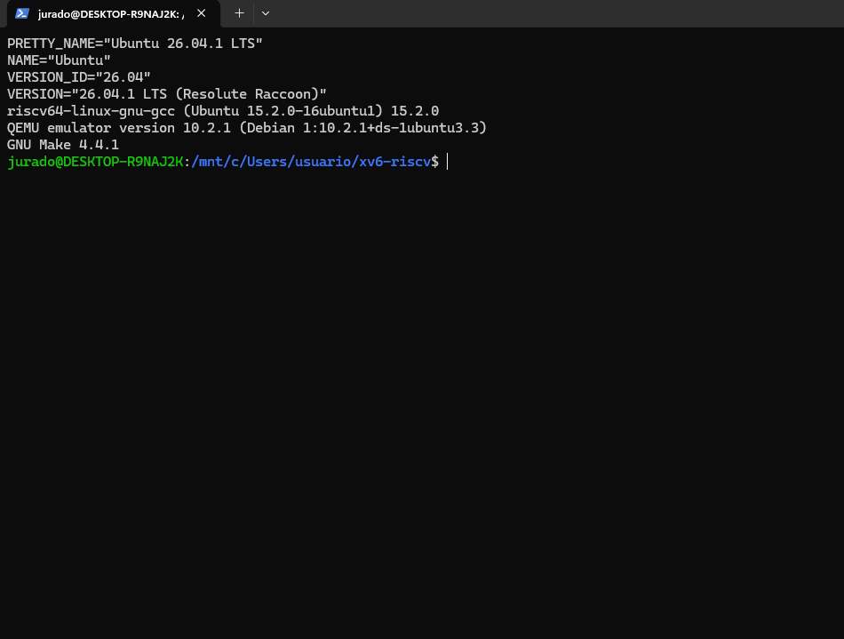

## 2. Compilación y ejecución

- **Comando:** `make qemu CPUS=1`
- **Cómo se define el número de CPUs:** el `Makefile` define `CPUS := 3` por defecto (línea 176) y lo pasa a QEMU con `-smp $(CPUS)` (línea 179). Con `CPUS=1` queda `-smp 1`.

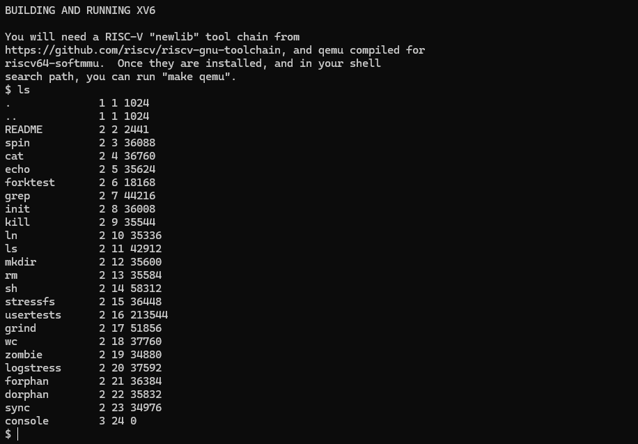
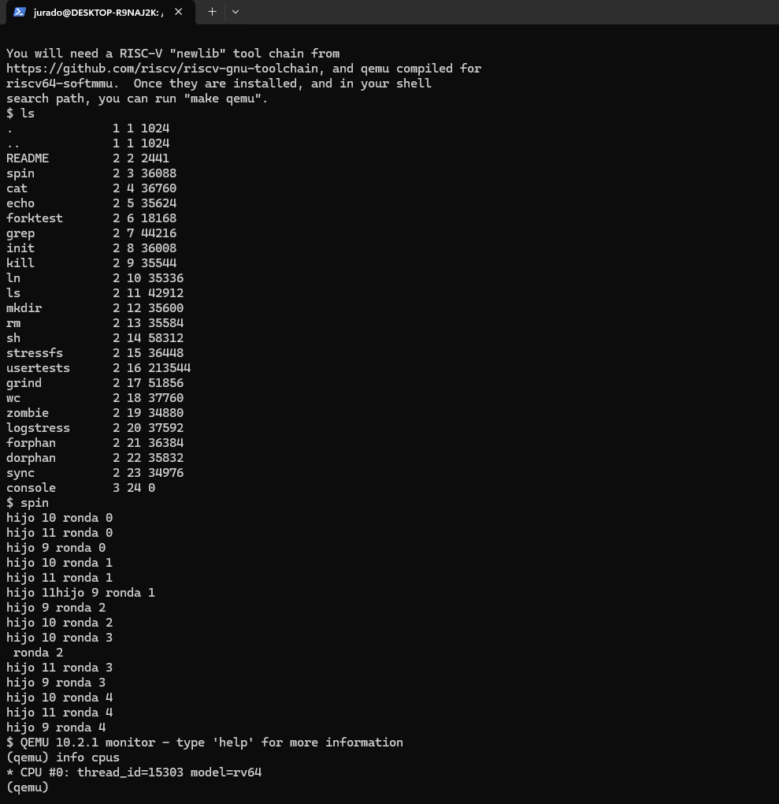
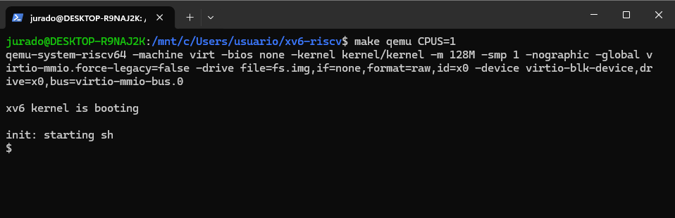
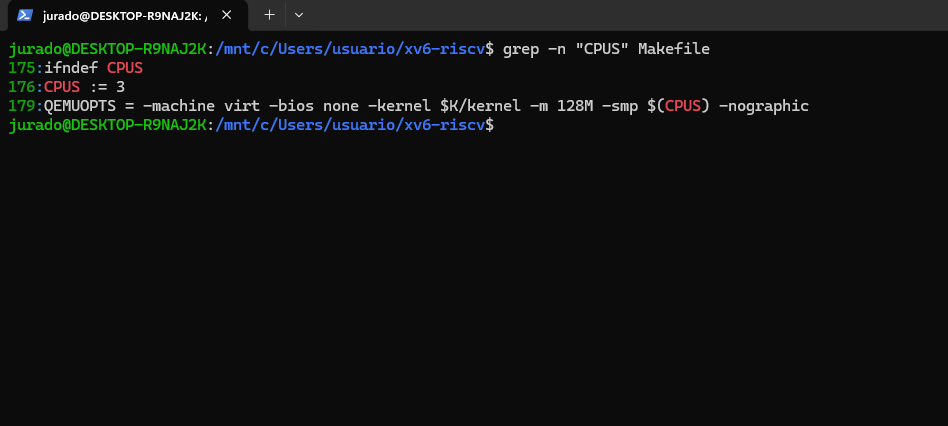

## 3. Planificador original

### i. Algoritmo y evidencia de comportamiento
XV6 utiliza un planificador **Round Robin cooperativo y expropiativo por interrupción de reloj**, sin niveles de prioridad ni historial de uso de CPU. El algoritmo recorre de forma circular el arreglo estático `proc[NPROC]` (`NPROC = 64` en `kernel/param.h:1`) mediante un bucle infinito `for(;;)` que itera desde `proc[0]` hasta `&proc[NPROC]`.

La rotación circular se produce de manera natural por cómo funciona el cambio de contexto: cuando `scheduler()` encuentra un proceso listo en la posición `i` (por ejemplo, el proceso en el índice `5`), ejecuta `swtch(&c->context, &p->context)` y cede la CPU. Cuando llega una interrupción del temporizador (`which_dev == 2` en `kernel/trap.c`), el proceso ejecuta `yield()` -> `sched()` -> `swtch(&p->context, &c->context)`, regresando exactamente a la instrucción siguiente al `swtch` dentro del ciclo `for` en el índice `5`. Allí libera `p->lock` y el puntero avanza (`p++`) al índice `6`, continuando el recorrido secuencial hasta el final del arreglo antes de reiniciar en `proc[0]`.

Al compilar e incorporar el programa de usuario `spin.c` en `UPROGS` dentro del `Makefile` y lanzar múltiples instancias concurrentes en QEMU con `CPUS=1`, la salida en consola intercala los caracteres/PIDs de los procesos activos en intervalos regulares de `1` tick, demostrando que ningún proceso monopoliza la CPU y que todos reciben turnos equivalentes.

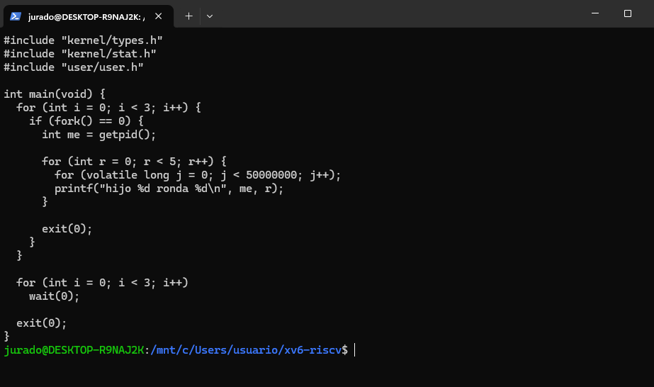
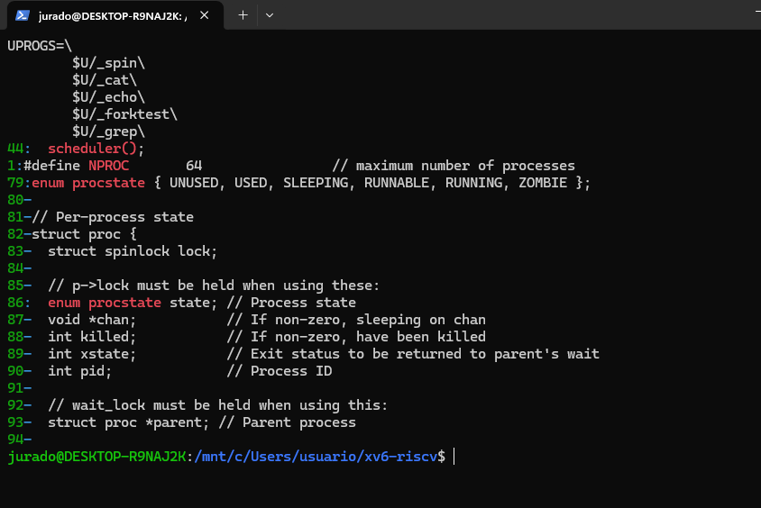
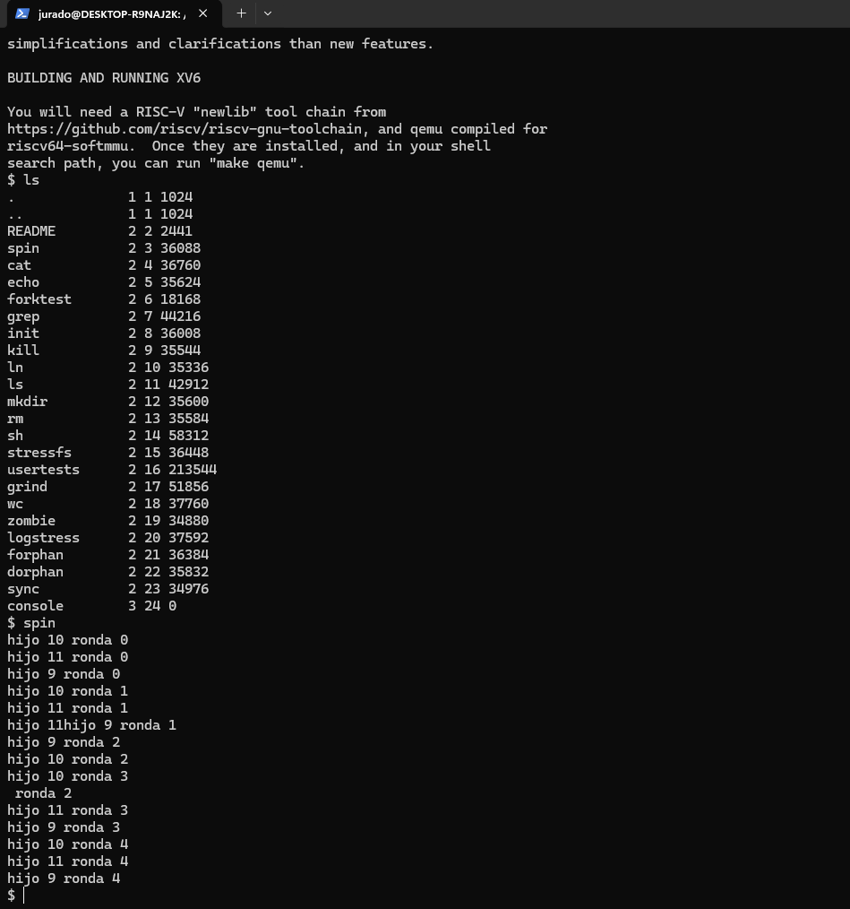

### ii. Archivo y función
La lógica de selección y despacho reside en la función `scheduler(void)` dentro del archivo **`kernel/proc.c`**. Para cada núcleo (*hart*), la función ejecuta un bucle infinito `for(;;)` donde habilita interrupciones (`intr_on()`), recorre la tabla `proc[]`, adquiere el candado individual `acquire(&p->lock)` y evalúa:

- `if (p->state == RUNNABLE)`: verifica si el proceso está listo para ejecutarse.
- `p->state = RUNNING;`: actualiza su estado antes de despacharlo para que ninguna otra CPU lo seleccione.
- `c->proc = p;`: registra en la estructura `struct cpu` actual qué proceso ocupa el núcleo.
- `swtch(&c->context, &p->context);`: guarda los registros del contexto del planificador y carga los del proceso elegido.

Cuando el proceso devuelve el control al planificador (por `yield()`, `sleep()` o `kexit()`), la ejecución retoma justo después de `swtch`, limpia `c->proc = 0;` y libera `release(&p->lock);`.

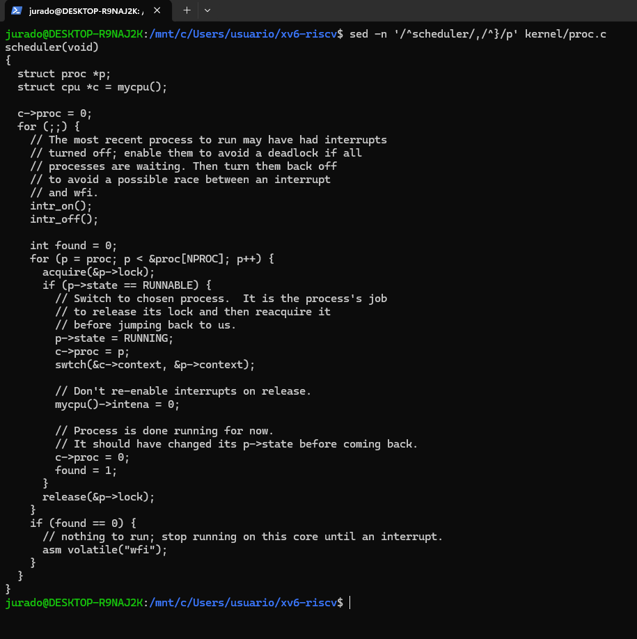

### iii. Estados y eventos
En `kernel/proc.h`, el ciclo de vida de un proceso se define mediante `enum procstate { UNUSED, USED, SLEEPING, RUNNABLE, RUNNING, ZOMBIE };`. Cuando `allocproc()` reserva una entrada libre pasa de `UNUSED` a `USED` y, tras configurar su contexto (`fork()`/`userinit()`), queda en `RUNNABLE`; al finalizar, `wait()` recoge el estado de un proceso `ZOMBIE` y lo devuelve a `UNUSED`. Las transiciones dinámicas durante la planificación ocurren según los siguientes eventos:

| Evento | Función | Cambio de estado |
|---|---|---|
| Interrupción de reloj | `usertrap()`/`kerneltrap()` -> `yield()` | RUNNING -> RUNNABLE |
| El proceso espera | `sleep()` | RUNNING -> SLEEPING |
| Llega lo esperado | `wakeup()` | SLEEPING -> RUNNABLE |
| El proceso termina | `kexit()` | RUNNING -> ZOMBIE |
| El scheduler lo elige | `scheduler()` | RUNNABLE -> RUNNING |

En `kernel/trap.c`, `devintr()` identifica la interrupción del temporizador (`scause == 0x8000000000000005L`, línea 214), invoca `clockintr()` (línea 215, donde `cpuid() == 0` incrementa `ticks++` bajo `tickslock` y despierta procesos con `wakeup(&ticks)`) y retorna `2`. Al recibir `which_dev == 2`, tanto `usertrap()` (línea 85) como `kerneltrap()` (línea 157) invocan `yield()`, provocando el cambio de estado de `RUNNING` a `RUNNABLE`.

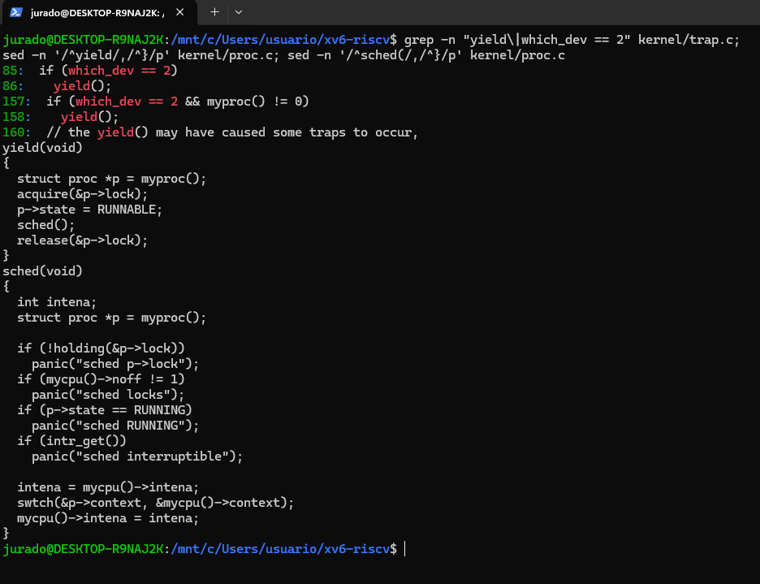
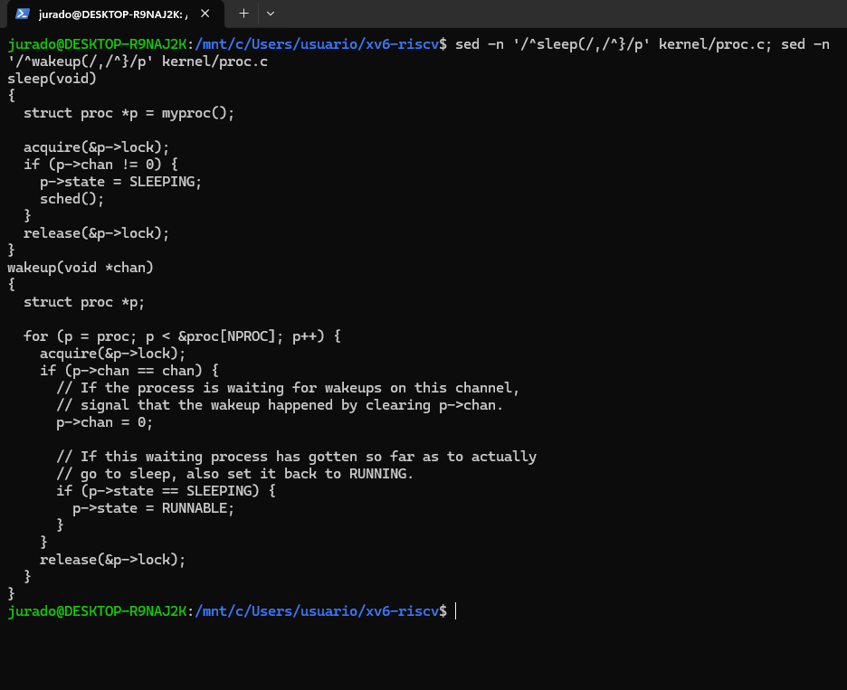
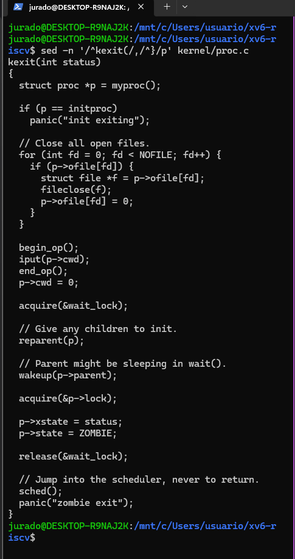
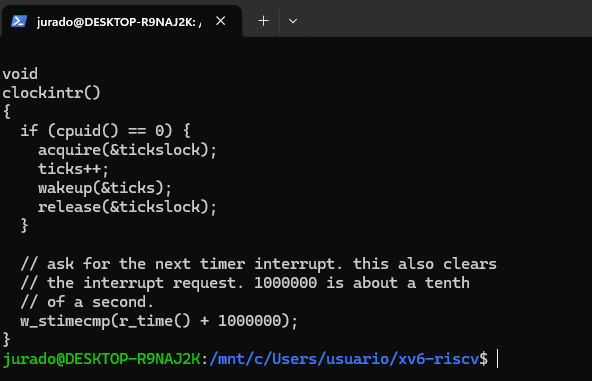
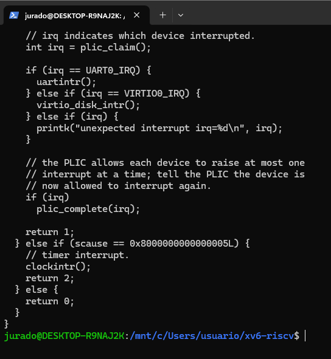
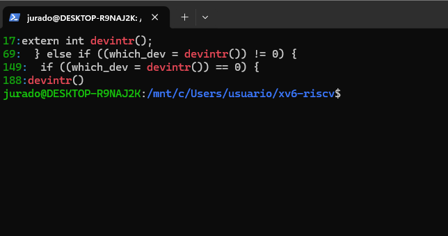

### iv. Incorporación al sistema compilado
El planificador se integra en la imagen final del kernel siguiendo la cadena de construcción definida en el `Makefile`:

1. **Compilación a código objeto:** Cada archivo fuente en C y ensamblador del núcleo (`kernel/proc.c`, `kernel/trap.c`, `kernel/main.c`, `kernel/swtch.S`, entre otros) se compila con `riscv64-linux-gnu-gcc` a su respectivo archivo objeto `.o`, listado en la variable `OBJS` del `Makefile`.
2. **Enlazado con `kernel.ld`:** El enlazador (`ld`) combina todos los `.o` de `OBJS` siguiendo el script `kernel/kernel.ld` (líneas 94–95, donde se ubican las secciones de código `.text` a partir de la dirección base del kernel `0x80000000`) para generar el binario ELF `kernel/kernel`.
3. **Carga en QEMU y entrada desde `main()`:** Al ejecutar `make qemu`, el `Makefile` pasa `-kernel kernel/kernel` a `qemu-system-riscv64` (línea 179). Durante el arranque en `kernel/main.c`, tras inicializar los subsistemas del kernel y sincronizar los núcleos mediante `started`, **la línea 44 de `main.c` invoca `scheduler();`**, entrando de forma permanente en el bucle de planificación.

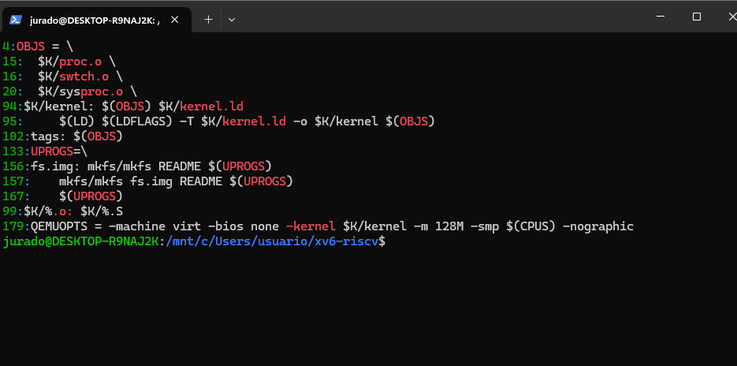

## 4. MLFQ

### Descripción inicial (escrita antes de consultar a la IA)
Después de revisar el capítulo de OSTEP y el video de clase, lo que recordamos de MLFQ es que el planificador organiza los procesos en varias colas con distintos niveles de prioridad (por ejemplo, de Q2 arriba como la más alta hasta Q0 abajo como la más baja), sin conocer de antemano cuánto va a durar cada trabajo. Todo proceso nuevo entra siempre en la cola de mayor prioridad asumiendo que podría ser corto o interactivo, y si hay varios procesos en el mismo nivel se turnan con Round Robin.

La prioridad no es fija, sino que cambia según el comportamiento observado del proceso: si consume todo su quantum (o su cuota de tiempo asignada en ese nivel) haciendo uso intensivo de CPU, el planificador lo degrada bajándolo una cola. En cambio, si hace operaciones de E/S (teclado, disco o red) y suelta la CPU antes de agotar su tiempo, conserva su prioridad para mantener buena respuesta interactiva, aunque se contabiliza el tiempo acumulado en ese nivel para evitar que un proceso haga trampa cediendo la CPU justo antes de acabar su turno.

Por último, como los procesos pesados de CPU terminan en la cola inferior y podrían sufrir inanición (starvation) si siguen llegando procesos interactivos, existe el priority boost: cada cierto periodo S, todos los procesos del sistema suben de nuevo a la cola más alta, lo que también ayuda si un proceso que antes era puro CPU cambia de fase y empieza a ser interactivo.

**Nuestras 3 dudas iniciales:**
1. **Cantidad de colas:** ¿Qué número de colas (por ejemplo 3 o 4 niveles) conviene usar en nuestra implementación para notar diferencias claras entre procesos sin complicar de más las estructuras del planificador?
2. **Duración del quantum en cada nivel:** ¿Es mejor mantener un quantum fijo en todas las colas o hacerlo más largo a medida que baja la prioridad para evitar demasiados cambios de contexto en los procesos de CPU?
3. **Frecuencia del priority boost (S):** ¿Con qué criterio práctico o cantidad de ticks deberíamos definir el intervalo S del boost para evitar inanición sin perjudicar el tiempo de respuesta de los procesos interactivos?

---

### Enlace a la conversación con la IA (Prompt 1)
* **Enlace:** https://share.gemini.google/puANNjXWfMdY

---

### Intercambios seleccionados del diálogo (Hipótesis -> Comprobación / Corrección)

1. **Niveles de prioridad, quanta por turno y cuota acumulada (Regla 4):**
   * *Hipótesis inicial:* En nuestro texto inicial mezclábamos conservar prioridad en E/S con tiempo acumulado, y dudábamos entre mantener *quanta* fijos o crecientes.
   * *Comprobación:* Frente a la granularidad del reloj de `xv6` (~`0.1` s por tick en QEMU), separamos el *quantum* por turno de la cuota acumulada (`ticks_in_level` no se reinicia en `sleep()`/`wakeup()`).
   * *Corrección:* Definimos `3` colas (`Q2` alta, `Q1` media, `Q0` baja) con *quanta* de `1`, `2` y `4` ticks y cuotas acumuladas de `2`, `4` e infinito ticks, reduciendo cambios de contexto en `Q0` e impidiendo evasiones por E/S repetitiva (documentando como límite conocido la evasión sub-tick menor a `1` tick).

2. **Periodo del *Priority Boost* y jerarquía de candados (`S = 40` ticks):**
   * *Hipótesis:* Propusimos reiniciar prioridades directamente dentro de `clockintr()` (`kernel/trap.c`) cada `S` ticks.
   * *Comprobación:* Como `sleep(&ticks, &tickslock)` en `xv6` adquiere `p->lock` antes que `tickslock`, recorrer `proc[]` tomando cada `p->lock` dentro de `clockintr()` invertiría la jerarquía de candados.
   * *Corrección:* Fijamos `S = 40` ticks (`15 %` en colas altas frente a `85 %` en `Q0`), haciendo que `clockintr()` solo active `need_boost = 1` y que `scheduler()` aplique el reinicio (`queue_level = 2`, `ticks_in_level = 0`, `quantum_ticks = 0`) únicamente sobre procesos activos (`SLEEPING`, `RUNNABLE`, `RUNNING` de `enum procstate`, excluyendo `UNUSED` y `ZOMBIE`).

3. **Sesgo por índice fijo en `scheduler()` (`cursor[3]`) y expropiación:**
   * *Hipótesis:* Recorrer `proc[NPROC]` siempre desde `proc[0]` bastaba para despachar por prioridad.
   * *Comprobación:* Al haber dos procesos listos en `Q2` (por ejemplo en índices `5` y `7`), empezar siempre en `0` despacharía siempre al índice menor, rompiendo el *Round Robin* (Regla 2).
   * *Corrección:* Incorporamos un cursor circular independiente por cola (`cursor[3]`), expropiación al cierre del tick (`which_dev == 2`) si aparece un proceso `RUNNABLE` en una cola superior, y reinicio de `quantum_ticks = 0` en `yield()` y `sleep()` conservando `ticks_in_level`.

4. **Observabilidad no intrusiva (`getpinfo`) y seguridad de `copyout()`:**
   * *Hipótesis:* Medir con `printf()` dentro de los bucles de prueba serviría para validar el planificador.
   * *Comprobación:* Llamar a `printf()` bloquea los procesos por E/S de consola y altera su clasificación; además, llamar a `copyout()` sosteniendo `p->lock` es inseguro con interrupciones deshabilitadas.
   * *Corrección:* Diseñamos `sys_getpinfo(struct pstat *)` llenando una estructura local en el stack del kernel bajo cada `p->lock` y ejecutando `copyout()` al final sin candados tomados, junto con tres cargas de usuario (interactivo vs. CPU-bound, rescate en tick `40` y proceso tramposo).

5. **Coordinación en el tick `40` (`need_boost` vs. degradación en `trap.c`):**
   * *Hipótesis:* En el tick `40`, `trap.c` degradaría el proceso antes de entrar a `scheduler()`.
   * *Comprobación:* Si un proceso en `Q1` o `Q0` va a mitad de un *quantum* multi-tick en el tick `40` y no hay procesos arriba, no llamaría a `yield()` por sí solo, retrasando el *boost*.
   * *Corrección:* En `usertrap()`/`kerneltrap()` (`which_dev == 2`) incrementamos primero los contadores históricos (`total_ticks` y `ticks_per_queue`), omitimos la degradación si `need_boost == 1` y añadimos `|| need_boost` a la condición de `yield()` para aplicar el *boost* puntualmente en el tick `40`.

---

### Datos por proceso y decisiones de diseño cerradas

| Dato / Estructura | Ubicación | Regla que lo exige | Evidencia en código |
| :--- | :--- | :--- | :--- |
| `int queue_level` | `struct proc` (`kernel/proc.h`), bajo `p->lock` | Reglas 1, 3, 4 y 5 (nivel de cola `0..2`) | Campo nuevo (en `kernel/proc.h` hoy solo existen `state`, `chan`, `killed`, `xstate`, `pid` bajo `p->lock`). |
| `int ticks_in_level` | `struct proc` (`kernel/proc.h`), bajo `p->lock` | Regla 4 revisada (cuota acumulada por nivel) | Campo nuevo (`kernel/trap.c` hoy llama a `yield()` sin contabilizar ticks por proceso). |
| `int quantum_ticks` | `struct proc` (`kernel/proc.h`), bajo `p->lock` | Regla 2 (*quanta* de `1`, `2` y `4` ticks por nivel) | Campo nuevo (reiniciado a `0` en `yield()` y `sleep()`). |
| `uint ticks` y `tickslock` | `kernel/trap.c` (líneas 9–10 y 167–174) | Regla 5 (referencia temporal global cada `S = 40` ticks) | Ya existen en `kernel/trap.c` (`img/19-clockintr.png`). |

**Decisiones cerradas:**
* **Contabilización por núcleo:** Se realiza en `usertrap()`/`kerneltrap()` (`which_dev == 2`) usando `myproc()` y no dentro del `if (cpuid() == 0)` de `clockintr()`, para que el diseño sea válido tanto con `CPUS=1` como en multiprocesamiento.
* **Inmutabilidad de cuota en E/S:** `sleep()` y `wakeup()` (`kernel/proc.c`) **no modifican** `queue_level` ni `ticks_in_level` (solo reinician `quantum_ticks = 0` al ceder la CPU); la cuota acumulada sobrevive a la espera de E/S y solo se reinicia a `0` al degradar nivel o en el *boost*.
* **Estados alcanzados por el *boost*:** Al recorrer `proc[NPROC]` (`64` entradas en `kernel/param.h:1`), el reinicio aplica solo a procesos activos (`SLEEPING`, `RUNNABLE`, `RUNNING`), excluyendo `UNUSED` y `ZOMBIE` (`enum procstate` en `kernel/proc.h`, `img/22-nproc.png`).

---

### Decisiones pendientes por investigar (lista centralizada)
1. **Calibración experimental (`voodoo constants`):** Validar en ejecución real si `N = 3` colas, *quanta* `{4, 2, 1}`, cuotas `{0, 4, 2}` y `BOOST_TICKS = 40` requieren ajuste según cargas mixtas.
2. **Escalabilidad a multiprocesamiento (`CPUS > 1`):** Verificar el comportamiento de `cursor[3]` y de la bandera `need_boost` cuando múltiples núcleos ejecutan `scheduler()` simultáneamente.
3. **Granularidad sub-tick:** Evaluar si en futuras extensiones conviene usar lectura de ciclos de hardware (`r_time`/`rdtime`) para medir ráfagas menores a `1` tick sin penalizar procesos interactivos legítimos.

---

### Escenarios de comprobación (diseño conceptual)

* **Escenario 1 — Rescate por *Priority Boost* (Regla 5):**
  * *Procesos y parámetros:* `C` (cálculo puro) frente a `I1` e `I2` (interactivos con ráfagas cortas + `sleep()`), con `3` colas (`Q2` a `Q0`), cuotas `2/4` y periodo `S = 40` ticks.
  * *Comportamiento esperado:* `C` desciende hasta `Q0` y queda sin CPU mientras `I1` e `I2` alternan en `Q2`. Al cumplirse el tick `40` (`need_boost == 1`), todos suben a `Q2` con `ticks_in_level = 0` y `C` vuelve a recibir turnos. *Fallo:* `C` sigue en `Q0` tras el tick `40` o cae en `1` tick por no reiniciarse su acumulado. *Evidencia observable:* `getpinfo()` muestra a `C` regresando a `queue_level = 2` inmediatamente tras el tick `40`.

* **Escenario 2 — Cuota acumulada vs. Proceso tramposo (Regla 4 revisada):**
  * *Procesos y parámetros:* `C` (cálculo puro) frente a `B` (ejecuta `1` tick y llama a `sleep()`), con `3` colas y cuotas `2/4`.
  * *Comportamiento esperado:* `B` conserva `ticks_in_level` tras `sleep()`/`wakeup()`, completa `2` ticks en `Q2` y `4` en `Q1`, y desciende a `Q0` compartiendo la CPU con `C`. *Fallo:* `B` permanece arriba acaparando CPU (indicaría reinicio de acumulado en E/S). *Límite conocido:* Si `B` duerme en menos de `1` tick antes de la interrupción de reloj, acumula `0` ticks. *Evidencia observable:* Distribución similar de `ticks_per_queue[0]` entre `B` y `C` en `getpinfo()`.

* **Escenario 3 — Ingreso de proceso nuevo en cola superior (Regla 3):**
  * *Procesos y parámetros:* `C` (largo, ya relegado en `Q0`) y `N1` (nuevo y corto, duración <= `2` ticks, llega antes del tick `40`).
  * *Comportamiento esperado:* `allocproc()` ubica a `N1` en `Q2` con `ticks_in_level = 0`; al cerrar el tick vigente (`which_dev == 2`), `C` cede la CPU por existir un `RUNNABLE` en `Q2` y `N1` finaliza sin descender. *Fallo:* `N1` queda esperando detrás de `C` en `Q0`. *Evidencia observable:* `N1` completa su ejecución antes de que `C` avance significativamente en `Q0`.

* **Escenario 4 — *Round Robin* dentro del mismo nivel (Regla 2):**
  * *Procesos y parámetros:* Tres procesos homogéneos de cálculo puro `P1`, `P2` y `P3` (inspirados en `spin.c`) en `Q2`.
  * *Comportamiento esperado:* Alternan turnos circulares mediante `cursor[2]` (`1` tick), `cursor[1]` (`2` ticks) y `cursor[0]` (`4` ticks) manteniendo un reparto cercano a `1/3` cada uno. *Fallo:* `P1` monopoliza la CPU por sesgo de índice menor en `proc[]`. *Evidencia observable:* Valores equilibrados de `total_ticks` y `ticks_per_queue` en `getpinfo()`.

---

### Conclusiones y caso final de comprobación

#### Conclusiones (propuesta de diseño sin implementar)
Frente a nuestra descripción inicial (donde mezclábamos reinicio en E/S con tiempo acumulado), la **Regla 4 revisada** mantiene `ticks_in_level` intacto tras `sleep()`/`wakeup()` y solo lo reinicia a `0` al bajar de cola o en el *boost*. Asimismo, decidimos que **`sleep()` y `wakeup()` (`kernel/proc.c`) no modifican** ni nivel ni cuota acumulada (reiniciando únicamente `quantum_ticks = 0` al ceder la CPU). Para llevar este diseño a **xv6** se plantea una **propuesta arquitectónica (aún no implementada ni probada en código)** con cuatro cambios: (1) definir `NQUEUE = 3`, `BOOST_TICKS = 40`, *quanta* `{4, 2, 1}` y cuotas `{0, 4, 2}` en `kernel/param.h`, agregando `queue_level`, `ticks_in_level`, `quantum_ticks` y métricas para `getpinfo()` en `struct proc` (`kernel/proc.h`); (2) contabilizar ticks y degradar nivel en `usertrap()`/`kerneltrap()` (`kernel/trap.c`, `which_dev == 2`) forzando `yield()` si agota quantum, aparece un `RUNNABLE` superior o `need_boost == 1`; (3) actualizar `scheduler()` (`kernel/proc.c`) para aplicar el *boost* mediante `need_boost` sobre procesos activos y seleccionar con cursores circulares `cursor[3]` sobre `proc[NPROC]`; y (4) exponer `sys_getpinfo()` copiando a un `struct pstat` local bajo cada `p->lock` antes de llamar a `copyout()`.

#### Caso de comprobación (`Q = 4`, quantum = `1` tick, sin *boost*)
Con orden inicial `A` -> `B` -> `C` en la cola superior, donde `A` y `C` son de cálculo puro y `B` consume `1` tick, duerme `1` tick y despierta:

| Tick | Proceso en CPU | Evento al cerrar el tick | `A` | `B` | `C` | Estado de colas |
| :---: | :---: | :--- | :---: | :---: | :---: | :--- |
| **1** | `A` | `A` agota quantum (`1` tick) y cede (`yield`) | **1/4** | 0/4 | 0/4 | Todos en cola alta |
| **2** | `B` | `B` consume `1` tick y llama a `sleep()` | 1/4 | **1/4** | 0/4 | Todos en cola alta |
| **3** | `C` | `C` corre; al final `B` despierta (`RUNNABLE`) | 1/4 | 1/4 | **1/4** | Todos en cola alta |
| **4** | `A` | `A` agota quantum (`1` tick) y cede | **2/4** | 1/4 | 1/4 | Todos en cola alta |
| **5** | `B` | `B` consume `1` tick y llama a `sleep()` | 2/4 | **2/4** | 1/4 | Todos en cola alta |
| **6** | `C` | `C` corre; al final `B` despierta (`RUNNABLE`) | 2/4 | 2/4 | **2/4** | Todos en cola alta |
| **7** | `A` | `A` agota quantum (`1` tick) y cede | **3/4** | 2/4 | 2/4 | Todos en cola alta |
| **8** | `B` | `B` consume `1` tick y llama a `sleep()` | 3/4 | **3/4** | 2/4 | Todos en cola alta |
| **9** | `C` | `C` corre; al final `B` despierta (`RUNNABLE`) | 3/4 | 3/4 | **3/4** | Todos en cola alta |
| **10** | `A` | `A` alcanza **4/4** -> **baja de nivel** y reinicia a `0` | **4/4 -> 0** | 3/4 | 3/4 | **`A` degradado**; `B`, `C` arriba |

* **Puntos donde la regla no decide sola:** El desempate inicial en el tick 1 (`A` -> `B` -> `C`) y cómo se modela en interrupciones discretas el patrón de `B` (*usar 1 tick y luego dormir*, dado que el cobro por interrupción ocurre en `yield()` dejando el proceso `RUNNABLE`). Además, si `B` durmiera `2` ticks (ticks 3–4) y despertara en el tick 5, `A` seguiría corriendo en los ticks 1, 4, 7 y 10 bajando igualmente en el **Tick 10**; `A` solo bajaría en el **Tick 7** si `B` nunca llegara a ocupar turno de CPU.

---

## 5. Reflexión individual

* **Santiago Jurado González:** A lo largo de esta práctica comprendí cómo opera la planificación de procesos dentro de un núcleo real como XV6, conectando la teoría de colas multinivel con el flujo concreto del código en `kernel/main.c`, `kernel/proc.c`, `kernel/trap.c` y `kernel/proc.h`, desde las transiciones de estado en `enum procstate` y el cambio de contexto mediante `swtch()` hasta la sincronización con *spinlocks* (`p->lock` y `tickslock`) ante interrupciones de reloj. Al trabajar de forma individual, aporté la exploración completa del repositorio y sus capturas de respaldo, la validación experimental del planificador base con `spin.c`, la identificación de inconsistencias en nuestra especificación inicial de MLFQ (cuota acumulada frente a reinicio por E/S, evasión sub-tick, sesgo por índice fijo en `proc[]`, jerarquía de candados en el *boost* y orden de ejecución entre `clockintr()` y `usertrap()`/`kerneltrap()`), así como la formulación de los escenarios de comprobación. Como trabajo pendiente por profundizar me queda implementar en C los cambios propuestos sobre el kernel, validar su comportamiento en escenarios multiprocesador (`CPUS > 1`) asegurando que no existan interbloqueos entre candados, y calibrar experimentalmente los parámetros `N`, `Q` y `S`.
